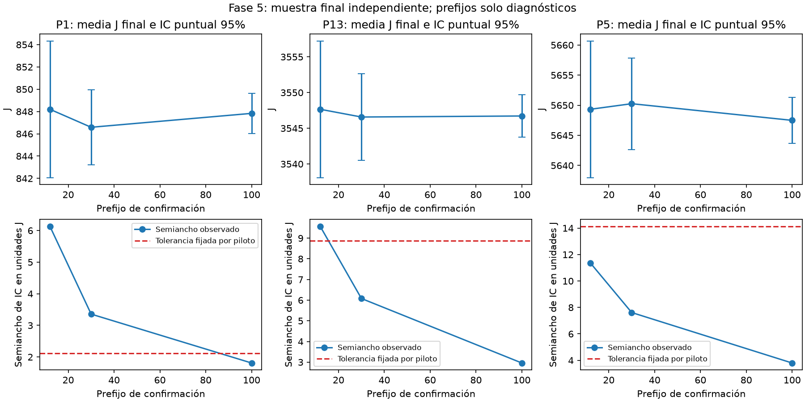

# Fase 5: Monte Carlo espacial y precisión de la media

La fase 5 añade un ejecutor independiente; conserva el pipeline, DSATUR,
las búsquedas locales Python/C++, la matriz C y la planificación económica.
La referencia inicial es `a323ddf`. Solo se modifican archivos en DSATUR.

## Ejecutar

Desde DSATUR, con las dependencias actuales y C++ compilado cuando se elige:

```shell
python scripts/escalar_monte_carlo.py --motor cpp --workers 2 --optimizar-posiciones --vecindad-posiciones mixta
python tests/verificar_monte_carlo.py
```

Sin opciones se usa Python y un proceso; posiciones sigue desactivada por
defecto. Se admiten `--poligonos 1,13,5`, `--semilla`, `--piloto`, `--minimo`,
`--maximo`, `--relativo`, `--absoluto`, `--confianza`, `--benchmark` y las
opciones de posiciones indicadas. No modifica Config ni las CLI anteriores.
No hay fallback de motor. Cada ejecución crea una carpeta fechada nueva.

## Diseño estadístico

El inventario y sus especies se conocen. Las compras se planifican una vez
por polígono, se validan y permanecen fijas durante Monte Carlo. La variación
corresponde a coordenadas simuladas de existentes y a propuestas de los
algoritmos bajo los supuestos vigentes; no a compras aleatorias, mortalidad
o datos observados de supervivencia.

El piloto usa índices 0–29. Su media y desviación muestral de J final fijan
`epsilon = max(absoluto, relativo * abs(media_piloto))`. La estimación es
`ceil((t_(1-alpha/2,m-1) * s_piloto / epsilon)^2)`, sujeta a un mínimo
preestablecido de 100 y máximo de 1000. El mínimo reduce la dependencia de
una estimación piloto pequeña y permite inspeccionar convergencia; no es una
garantía universal de precisión ni certifica percentiles extremos. El tamaño
común de los polígonos es el mayor de sus tamaños acotados, para poder formar
sumas por escenario. Se registra la necesidad sin mínimo, el mínimo, el
truncamiento y la tolerancia. Si no hay dos resultados válidos del piloto se
detiene con error y quedan sus filas, sin inventar un tamaño.

La confirmación usa índices 30–(30+n−1), sin solapamiento con piloto. El tamaño
se fija antes de verla. No hay parada opcional al alcanzar precisión ni
reemplazo de fallos. El benchmark repite índices del piloto y se excluye de
todos los denominadores de confirmación. Un máximo alcanzado se informa;
la precisión se contrasta con el semiancho observado al terminar. No se
extiende automáticamente el lote si no se alcanza.

Para cada métrica, con n valores finitos válidos, se calcula media, desviación
con ddof=1, `SE = s/sqrt(n)` e IC puntual de Student
`media ± t_(1-alpha/2,n-1) * SE`. Son IC aproximados para escenarios
independientes, apoyados en la aproximación de la media; no se afirma
normalidad exacta de J. Se publican percentiles empíricos 5/25/50/75/95 con
interpolación lineal, sin IC de cuantiles. Los percentiles describen escenarios;
el IC describe incertidumbre de estimación de su media. Con cero valores
no hay media; con uno no hay desviación, SE ni IC. Una serie constante tiene
SE cero, lo cual no elimina el error del modelo. Una media cero no recibe
semiancho relativo; sigue disponible la precisión absoluta.

Se registran solicitados, válidos y excluidos por métrica. Las construcciones
fallidas/omisiones conservan índice y motivo, sin J=0. Con exclusiones, la
inferencia es condicional a construcciones válidas y puede tener sesgo de
selección. Errores técnicos y de invariantes se propagan y abortan la entrega
normal; no se convierten en incertidumbre espacial.

La convergencia presenta prefijos preestablecidos 12/30/100/300/1000 y final,
recortados al tamaño elegido. Es un diagnóstico: sus IC no tienen cobertura
simultánea ni justifican selección posterior del prefijo. El objetivo de
precisión aplica solo a J final por polígono. Otros objetivos, mejoras y
agregados tienen intervalos descriptivos sin control de multiplicidad. La
reducción absoluta se calcula de forma pareada J base−J final por escenario;
la mejora porcentual media es la media de cocientes, no un cociente de medias.

## Paralelismo, agregación y trazabilidad

Los flujos originales son `SeedSequence([semilla,p,e]).spawn(3)` y posiciones
`SeedSequence([semilla,p,e,104729])`; no dependen del orden ni del proceso.
El ejecutor emplea spawn, un hilo BLAS/OMP por proceso, hasta 2*workers futuros
y devuelve filas escalares/hashes en orden determinista. Cada trabajador
retiene un grafo por vez; el padre retiene O(polígonos*escenarios) filas,
sin distribuciones. La vista económica se reconstruye dentro del proceso
para evitar la recursión de su delegación al deserializarla en Windows.

`agregado.csv` suma J exclusivamente cuando están completos todos los
polígonos solicitados del mismo índice. La mejora global es el cociente de
esas sumas; no suma medias marginales ni mezcla realizaciones. Un subconjunto
P1/P13/P5 no representa los 30 polígonos. La salida agregada no calcula
J local de especies porque el agregador histórico no lo incluye: figura sin
valores válidos y sin IC, en lugar de imputarse.

Archivos: piloto/confirmacion/benchmark_serial/benchmark_paralelo en CSV y
JSONL; planes.json; diseno.json; estadisticas.csv; convergencia.csv;
agregado.csv; estadisticas_agregadas.csv; benchmark.json y manifiesto.json.
JSONL se vacía a disco por fila. El manifiesto conserva configuración,
semillas, versiones, motor/binario, commit base, hashes de fuentes y tiempos.
El benchmark compara los mismos índices y comprueba hashes/objetivos exactos;
incluye arranque de procesos y escritura, excluye economía. Una repetición,
orden serie→paralelo: no establece una aceleración universal ni variabilidad
de tiempos. No se mide RSS nuevo; la memoria acotada es una propiedad del
planificador, no una medición de consumo.

## Límites

Rectángulos simulados; geometrías aportadas aún sin integrar. C heurística,
búsqueda acotada y ausencia de certificado de óptimo espacial permanecen.
Los intervalos no cuantifican error geométrico, incertidumbre de C, sesgo del
inventario o validez ecológica. No hay modelo competencia→supervivencia.
Fases 2/3 pendientes o pospuestas y fases 6–8 fuera del alcance.

## Validación de esta entrega — 23 de octubre de 2026

Evidencia final en
[monte_carlo_fase5_20261023T194341_763740Z](../resultados/monte_carlo_fase5_20261023T194341_763740Z/).
Comando de ejecución indicado arriba: C++, dos procesos y vecindad mixta,
6000 propuestas de especies y 6000 de posiciones, semilla 20261014.
CPython 3.12.10, Windows, NumPy 2.5.4, SciPy 1.18.1, pandas 3.0.6.

El piloto produjo 30/30 válidos por polígono. La necesidad estimada sin el
mínimo fue 33 (P1), 12 (P13) y 7 (P5); se aplicó el mínimo de 100 a los tres,
sin truncamiento. Confirmación índices 30–129: **300/300 válidos**, cero
excluidos, todos económica y espacialmente verificados. Ningún resultado
del piloto o benchmark entra en las estadísticas finales.

|Polígono|Media J final|SE|IC puntual 95% de la media|P5–P95 empíricos|Tolerancia del piloto|Semiancho observado|
|---|---:|---:|---|---|---:|---:|
|P1|847.834704|0.911996|846.025107–849.644302|833.694109–861.486119|2.112893|1.809598|
|P13|3546.717301|1.491387|3543.758066–3549.676536|3524.106214–3572.104163|8.873773|2.959235|
|P5|5647.490177|1.913531|5643.693316–5651.287037|5614.931399–5676.680323|14.138604|3.796860|

Los tres cumplen la tolerancia de la media J final. P1 pasa de un semiancho
6.135 aproximadamente con 12 confirmaciones a 1.810 con 100; se conservan
los valores exactos en convergencia.csv. La media no tiene que converger
monótonamente. Los 100 agregados completos del subconjunto P1/P13/P5 tienen
media 10042.042182, SE 2.469114 e IC 10037.142924–10046.941439; no representan
los 30 polígonos. La elección de 100 basta para este criterio/semilla/modelo,
sin afirmar que siempre baste ni requerir 1000 automáticamente.



Tiempos de pared: piloto **10.923880 s**, confirmación **34.109311 s**.
Benchmark separado, 12 índices por los tres polígonos (36 realizaciones por
modo): serie **9.459318 s**, dos procesos **6.337599 s**, razón **1.492571**.
Hashes de entradas, soluciones y objetivos exactamente iguales en los dos
modos. Son tiempos del ejecutor completo según el alcance descrito arriba;
no se suman tiempos de procesos como pared. No se ejecutaron nuevas cargas
de 1000/10000 ni 100 por cada uno de los 30 polígonos.

La carpeta previa `monte_carlo_fase5_20261023T194210_740803Z` conserva la
ejecución preliminar antes de completar metadatos: mismos resultados
espaciales, benchmark de razón 1.110433. Se identifica como preliminar,
sin mezclar sus observaciones ni promediar sus tiempos con los finales.
La diferencia entre mediciones refuerza el límite de un benchmark individual.

Pruebas: **42/42**, cero fallos finales (9 modelo, 6 economía, 5 C++,
16 posiciones, 6 Monte Carlo), logs y tiempos por batería en la carpeta final.
La batería nueva cubre IC conocido, faltantes/cero/una observación,
planificación y topes, agregación incompleta/duplicados, propagación de
errores y equivalencia de semillas, cuotas y hashes Python/C++/procesos.
La validación adicional de regresiones y preservación se registra en
`validacion.json`, `regresion_fase4.csv` y `preservados_sha256.json`.

Se verificaron **144/144** referencias de fase 4 (72 con posiciones apagadas
y 72 mixtas; P1/P13/P5 × 12 × ambos motores). Hashes idénticos de entradas y
soluciones; diferencia máxima de J 9.094947017729282e-13 al leer CSV, menor a
1e-8. Se preservaron **1407 archivos** por SHA-256, incluidos Algoritmo Genético,
datos, geometrías y evidencia histórica. La auditoría independiente recalculó
IC/denominadores y sumas, verificó fuentes del manifiesto y confirmó las 34
celdas previas del notebook sin cambios. Regresión y auditoría: 94.185698 s,
separados de los benchmarks.

Durante desarrollo se detectó RecursionError al transferir DatosConCuotas a
spawn; se corrigió reconstruyendo la vista con Datos y el plan en el proceso.
La prueba serie/paralelo pasa con la corrección; no se cambió la clase
económica ni su formulación. El notebook añade exclusivamente una celda
documental opcional y conserva sus celdas anteriores con salidas/metadatos.
La figura anterior se inspeccionó visualmente; no se ejecutó de nuevo el
notebook histórico porque sus celdas ejecutables permanecen idénticas.
